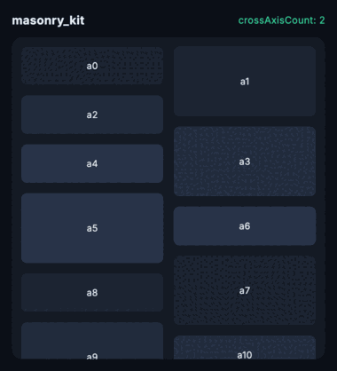
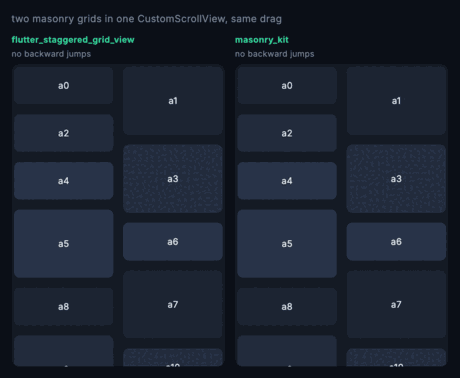

# masonry_kit

A staggered / masonry grid for Flutter — Pinterest-style columns of uneven
height, as a sliver or a plain box widget.

You can put **more than one in the same scroll view** without the viewport
jumping backwards as you scroll, and the scrollbar barely moves while you do.

```dart
MasonryGridView.count(
  crossAxisCount: 2,
  mainAxisSpacing: 8,
  crossAxisSpacing: 8,
  itemCount: photos.length,
  itemBuilder: (context, index) => Photo(photos[index]),
);
```



## The problem


`flutter_staggered_grid_view` does 1.43M downloads a month. From 2022 its tracker
carried the same complaint — [#265](https://github.com/letsar/flutter_staggered_grid_view/issues/265),
[#244](https://github.com/letsar/flutter_staggered_grid_view/issues/244),
[#286](https://github.com/letsar/flutter_staggered_grid_view/issues/286),
[#338](https://github.com/letsar/flutter_staggered_grid_view/issues/338) —
put two `SliverMasonryGrid`s in one `CustomScrollView` and scrolling throws you
backwards.

**It is being fixed upstream.** On 3 November 2026 its author released
[0.8.0-dev.1](https://github.com/letsar/flutter_staggered_grid_view/releases/tag/v0.8.0-dev.1),
a rewrite of the masonry layout and the first release since July 2023. It is a
pre-release, so `flutter pub add` and `^0.7.0` still give you 0.7.0.

Running all of them through one harness, dragging forward 45 times:

| grids in one `CustomScrollView` | `flutter_staggered_grid_view` 0.7.0 | 0.8.0-dev.1 | `masonry_kit` |
| --- | --- | --- | --- |
| one | none | none | none |
| **two** | **2 jumps, worst 3,400px** | none | none |
| **four** | **3 jumps, worst 2,350px** | none | none |

Both panels below are dragged by the same finger, the same distance, at the
same moment. The left one, on 0.7.0, gets thrown back into the first grid:



## Why it happens

Masonry is sequential: you cannot know where item 400 goes without the measured
heights of the 399 above it. So the usual approach estimates, discovers it was
wrong, and asks the viewport for a `scrollOffsetCorrection`. That is a real part
of the sliver protocol, and it makes the viewport **throw away the layout pass
and start again**.

With one such sliver you mostly get away with it. With two, the second one's
correction restarts the pass, the first — now scrolled well past — re-runs into
its own "ran out of children before reaching the scroll offset" branch, and
hands back a correction the size of its entire offset. That is the 3,400px.

## What this does instead

Measure once, remember, never revise. Each item's column and offset are decided
the first time it is measured and are then permanent, so this sliver has no
reason to ever issue a correction — and it doesn't.

The same property makes the scrollbar honest, because measured items contribute
their exact extent and only the unmeasured tail is estimated:

| worst shrink in the reported scroll extent | |
| --- | --- |
| Flutter's own `SliverList` | 2,887px |
| `flutter_staggered_grid_view` 0.7.0 | 1,920px |
| `flutter_staggered_grid_view` 0.8.0-dev.1 | 444px |
| **`masonry_kit`** | **145px** |

400 items, 45 forward drags — `test/head_to_head_test.dart` runs it, so the
figures for `SliverList`, 0.7.0 and this package cannot quietly stop being true.
0.8.0-dev.1 is measured by pointing the same test at it, last on 4 November 2026;
CI stays on the stable release. The absolute pixels depend on the item count and
cell heights; the order of magnitude is the claim. Note that Flutter's own lazy
estimate drifts furthest here: this is a property of estimating an unmeasured
tail, not a defect unique to any one package.

The first estimate differs too. Two grids of 60 items really end at 5,986px.
Here the first estimate is 6,034, so a jump to the end lands there. On 0.8.0-dev.1
it is 2,711, so the first jump stops about halfway and a second one is needed.

## Feeds with no end

`itemCount` is optional. Leave it out and the grid discovers the end when the
builder returns null, the same contract `ListView.builder` has — so a paginated
feed works without knowing its length up front.

```dart
SliverMasonryGrid.builder(
  crossAxisCount: 2,
  itemBuilder: (context, index) =>
      index < loaded.length ? Photo(loaded[index]) : null,
)
```

`MasonryGridView.builder` is the same thing as a scrollable. Pass `itemCount`
when you do know the length — a known count lets the scroll extent be
estimated instead of reported as infinite, which is what keeps the scrollbar
meaningful.

## Sliver or box widget

`MasonryGridView` is the scrollable; `SliverMasonryGrid` is the same layout for
a `CustomScrollView`, and putting several in one is the entire point.

```dart
CustomScrollView(
  slivers: [
    const SliverAppBar(title: Text('Feed')),
    SliverMasonryGrid.count(crossAxisCount: 2, childCount: 40, itemBuilder: ...),
    const SliverToBoxAdapter(child: Divider()),
    SliverMasonryGrid.count(crossAxisCount: 3, childCount: 60, itemBuilder: ...),
  ],
);
```

Both take `mainAxisSpacing`, `crossAxisSpacing` and `crossAxisCount`.
`MasonryGridView` also takes the usual `BoxScrollView` arguments — `padding`,
`physics`, `controller`, `scrollDirection`, `reverse`, `shrinkWrap`,
`cacheExtent`, `findChildIndexCallback` and the rest — and works on either axis.

## What this does not do

**Only masonry.** `flutter_staggered_grid_view` also ships aligned, quilted, woven
and staired layouts. Those are not broken, so they are not here; if you use them,
stay where you are.

**A far jump measures its way there.** Because masonry is sequential, jumping to
the far end of an unvisited list has to measure everything in between. Ordinary
scrolling never notices, since the cache grows a screenful at a time, but a
scrollbar dragged from top to bottom of a very long grid will do real work.
That cost is the price of never lying about where an item is. It measures, but
it no longer *holds* — children already walked past are released as it goes, so
a jump to the end of a 2,000-item grid peaks at ~118 live subtrees rather than
1,808.

## Alternatives, honestly

`waterfall_flow` (20k downloads a month, maintained) does not have the
backwards-scrolling bug either, and if it suits you, use it. The difference is
the API: `SliverWaterfallFlow.count` takes a `List<Widget> children`, so lazy
building means restructuring your call site into a delegate. `masonry_kit`
keeps `itemBuilder`, so the switch from `flutter_staggered_grid_view` is an
import line.

`flutter_staggered_grid_view` is the right answer if you need aligned, quilted,
woven or staired layouts, or if you are below Flutter 3.24. Once 0.8.0 is stable
it is also a sound answer for masonry: the backward jump this package was written
for is gone there, and its new `mainAxisExtentBuilder` places children without
building them when you know their heights, so a far jump skips the walk this
package has to do. What this package still has is a stable release today, a
scrollbar that drifts less, and an end it estimates well from the start.

## License

MIT © K M Shahriar Hossain
